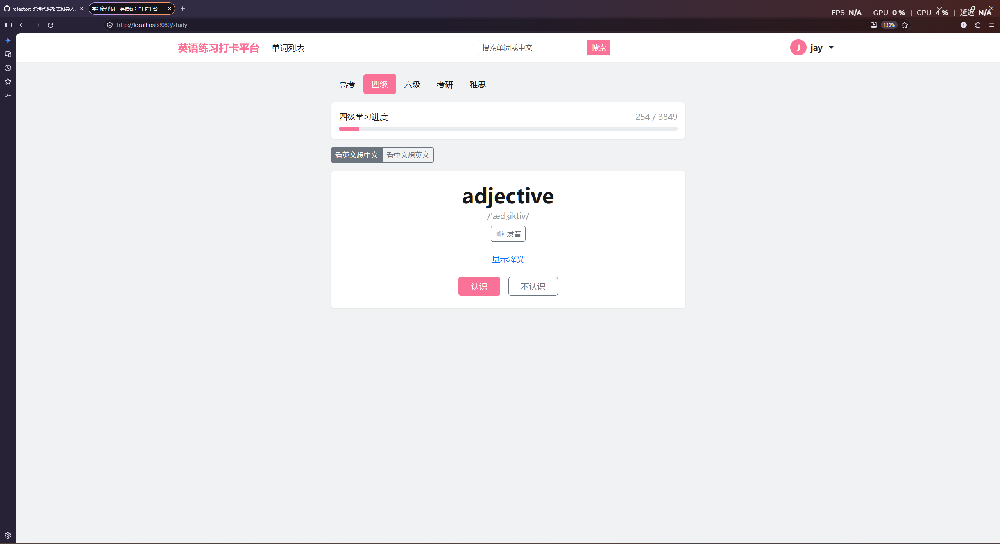
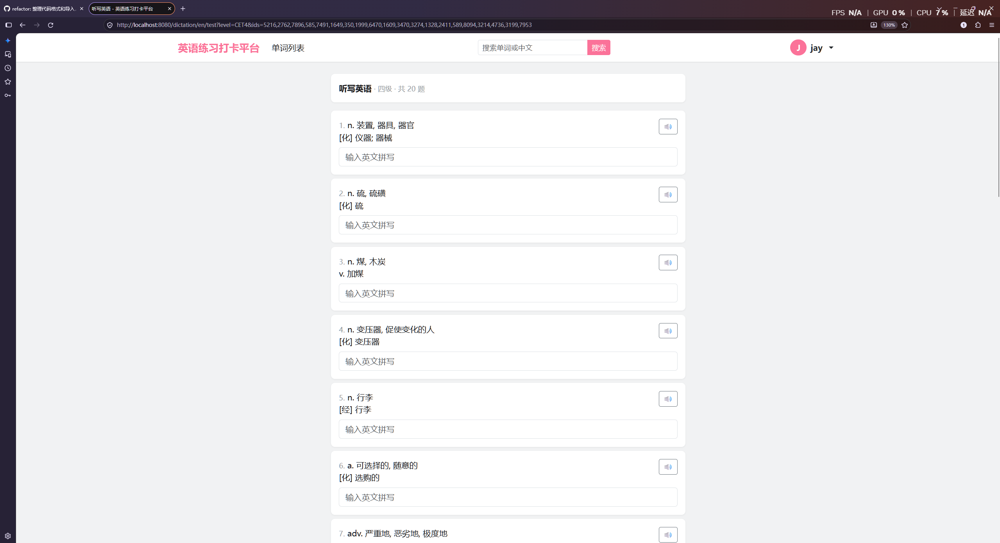

Diagnosing a port conflict from another running instance.
Diagnosing a port conflict from another running instance.
这次是新代码，好消息先说：

Successfully validated 6 migrations
Current version of schema `english_practice`: 6
V6 已经执行过了。说明在这次之前，你已经成功启动过一次新代码，或者跑过测试，表结构和词典数据在那时就建好、导入了。

这次启动失败的原因：8080 端口被占用
Web server failed to start. Port 8080 was already in use.
一个端口同一时间只能被一个程序监听。之前启动的那个程序还在运行，占着 8080，所以新启动的这个拿不到端口，只能退出。这和代码没有关系。

解决办法（任选一种）：

在 IDEA 里停掉：看底部「运行」窗口的各个标签，或者顶部工具栏，凡是有红色方块 ■ 亮着的，都点一下停止，然后再启动。
IDEA 里找不到的话，用命令行查是谁占着端口：在 PowerShell 或 cmd 里执行
netstat -ano | findstr :8080
最后一列是进程号（PID），比如 12345，然后执行

taskkill /PID 12345 /F
确认词典导入成功
因为导入只在第一次启动时执行，这次的日志里看不到。在 MySQL 里查一下：

sql
SELECT COUNT(*) FROM dict_entries;   -- 应该是 96387
SELECT source, COUNT(*) FROM words GROUP BY source;   -- CORE 8674，收藏过扩展词的话还有 EXTENDED
如果第一个结果是 0，就把 IDEA 里那次成功启动的日志找出来发给我。

截图里的插件报错
「Python Portable 与 IDE 不兼容」是 IDEA 的插件冲突，和项目无关。直接点 Disable Python Portable 关掉它，IDEA 自带的 Python 支持已经够用。

端口释放后再启动一次，按上次说的那几项手动测一遍，然后跑全部测试。

Microsoft Windows [版本 10.0.26200.9457]
(c) Microsoft Corporation。保留所有权利。

C:\Users\18320>   netstat -ano | findstr :8080
TCP    0.0.0.0:8080           0.0.0.0:0              LISTENING       18648
TCP    100.64.8.2:65328       43.135.106.161:8080    ESTABLISHED     28776
TCP    [::]:8080              [::]:0                 LISTENING       18648

C:\Users\18320>taskkill /PID 18648
错误: 无法终止 PID 为 18648 的进程。
原因: 只能强行终止这个进程(带 /F 选项)。

C:\Users\18320>

mysql> SHOW DATABASES
-> ;
+--------------------+
| Database           |
+--------------------+
| english_practice   |
| information_schema |
| performance_schema |
+--------------------+
3 rows in set (0.01 sec)

mysql> USE english_practice;
Database changed
mysql> SELECT COUNT(*) FROM dict_entries;
+----------+
| COUNT(*) |
+----------+
|    96387 |
+----------+
1 row in set (0.01 sec)

mysql> SELECT source, COUNT(*) FROM wrods GROUP BY source;
ERROR 1146 (4

两处都是小问题。

1. taskkill 要加 /F
   提示已经说了，这个进程只能强制结束：

taskkill /PID 18648 /F
只杀 18648。它是 LISTENING（监听）状态，占着 8080 的就是它，也就是你之前没关掉的那个项目实例。
第二行 PID 28776 不要动。它是你电脑上某个程序去连别人服务器的 8080（43.135.106.161:8080），本地 8080 是空的，和你的项目无关。
两者的区别：本地地址:8080 + LISTENING 表示"我在 8080 上等别人连"；远程地址:8080 + ESTABLISHED 表示"我连到了别人的 8080"。
2. 表名拼错了
   wrods → words：

sql
SELECT source, COUNT(*) FROM words GROUP BY source;
3. 词典导入成功
   dict_entries 是 96387 条，和脚本输出完全一致，扩展词典这部分没问题了。

杀掉进程后重新启动项目，按顺序手动测一下：

搜 give u，收藏 give up；
搜「苹果」；
用「我的词库」学习、听写；
看复习页的两个标签；
打开 /mistakes，应该会跳转。
然后跑全部测试。

面试准备_英语练习平台.doc
面试准备_英语练习平台.doc
DOC
欧克了，给我更新一下readme，在这后面更新一下最近的内容，最后给我讲怎么部署

Shared a file, read a file, and 15 more steps
更新面试准备文档的最新内容。
更新面试文档的readme内容。
Checking whether test files moved into a different directory.
Tracking down a missing test file and untracked changes.
Drafting the README text with the added introductory line.
Spotting a version mismatch in the README documentation.
三件事都做完了：面试文档、README、部署步骤。不过提交前有两个问题必须先处理。我刚看了你项目的 git status，发现：

DictionaryImporterTest.java 不见了。 main 和 test 下面都没有这个文件，可能是移动的时候删掉了。请重新建：src/test/java/com/jay/englishpracticeplatform/init/DictionaryImporterTest.java，内容用上上条消息里的代码。
src/main/resources/dictionary/ 还没被 Git 跟踪（状态显示 ??）。如果漏提交，服务器拉到的代码里就没有这个数据文件，程序启动时 DictionaryImporter 找不到它，整个网站都起不来。提交前用 git add -A，然后用 git status 确认它变成了 A。
一、面试文档
文件是 面试准备_英语练习平台.doc，保持了你原来的格式。

修正了 4 处已经过时的内容：
第 0 节项目介绍：加上了我的词库、扩展词典、改密码让其他设备下线；
Q4.6「改密码后怎么处理」：原来写的是"下一个要做的功能"，改成"已实现"；
Q8.2 发音：改成"优先真人音频 + 语音合成兜底"，并保留了"手机自动朗读仍会被拦截"这个不足。
末尾新增第 12 节，共 11 题。 重点看 Q12.5 方案对比、Q12.7 并发收藏与可重复读快照、Q12.8 批量导入与原子性，这三题最能体现思考深度。
Q12.8 里写了我讨论方案时说错过一个理由（"数据放 Flyway 会让每次测试都慢"），后来改正了。面试时这样讲"判断有误、后来纠正"，比假装一开始就全对更可信。
检查清单加了一项：能讲清楚 Q12.7。
二、README（完整版，直接替换）
相比上次给你的 7 处改动，这次又多改了 3 处：

开头加了扩展词典的介绍；
"运行测试"的说明里加上了扩展词典；
你原来的 README 写的是 MySQL（开发 26.7），这个版本号不存在。 你本地日志里显示的是 MySQL 8.4，两处都已改成 8.4。
markdown
# 英语练习打卡平台

一个基于 **Spring Boot** 的英语单词学习网站：背单词、间隔复习、错题本、听写、每日打卡、学习统计，以及可以收藏单词的个人词库。

考试词库覆盖 **高考、四级、六级、考研、雅思** 五个级别，共 8674 个单词；另有约 **9.6 万**个单词和短语的扩展词典，可以收藏到「我的词库」中学习。

**在线访问：http://122.51.247.76**

> 目前使用 HTTP 访问，暂未启用 HTTPS（域名备案中），注册时请不要使用在其他网站用过的密码。


| 学习 | 听写 | 打卡日历 |
|---|---|---|
|  |  |  |


---

## 功能

| 模块 | 说明 |
|---|---|
| **学习新单词** | 按级别或「我的词库」学习，支持「看英文想中文 / 看中文想英文」两种模式，进入新单词时自动朗读 |
| **间隔复习** | 根据记忆情况安排复习时间（1、2、4、7、15、30 天），答错则从头开始 |
| **错题本** | 在复习页的「错题本」标签中；答错过的单词自动进入，复习时连续答对 3 次后自动移出 |
| **听写** | 听写英语（看释义写拼写）、听写汉语（看单词四选一）；单词可来自全部单词、已学单词、错题本或「我的词库」；先预习再答题，题目顺序打乱；可用同一组单词重做或只练错题 |
| **我的词库** | 搜索并收藏单词，每人最多 600 个；除考试词库外，还可以从约 9.6 万个单词和短语的扩展词典中收藏（带「扩展」标记）；收藏的单词可以单独学习和听写 |
| **每日打卡** | 每天答题达到目标自动打卡（目标可自定义），记录连续天数、最长连续天数，月度热力图日历 |
| **学习统计** | 今日各模式答题数、累计正确率、各级别进度、近 7 / 30 天答题柱状图 |
| **单词列表与搜索** | 按级别浏览，支持英文和中文搜索，以搜索词开头的结果排在前面，匹配文字高亮显示 |
| **账号** | 注册、登录、退出、「记住我」、个人主页；修改用户名（需验证密码，3 天内只能改一次）、修改密码 |
| **更新日志** | 记录每次版本更新，登录后弹出最近一次更新（同一条最多提示 3 次），不登录也可以查看 |

---

## 技术栈

| 分类 | 技术 |
|---|---|
| 语言 | Java 21 |
| 框架 | Spring Boot 4、Spring MVC、Spring Security 7 |
| 持久层 | Spring Data JPA（Hibernate 7）、JdbcClient、Flyway |
| 数据库 | MySQL（开发 8.4，线上 8.0） |
| 页面 | Thymeleaf、Bootstrap 5.3、Chart.js 4、原生 JavaScript |
| 测试 | JUnit 6、Spring Boot Test、MockMvc |
| 部署 | Ubuntu 24.04、Nginx、systemd |
| 其他 | Lombok、Jackson 3、Maven、Git |

---

## 项目结构
src/main/java/com/jay/englishpracticeplatform
├── config/ 配置：Spring Security、密码加密
├── controller/ 控制器：接收请求、组织页面数据
├── dto/ 数据传输对象：页面展示用的数据、表单
├── entity/ JPA 实体
├── exception/ 业务异常
├── init/ 启动时导入数据：考试词库、扩展词典
├── repository/ 数据访问
├── security/ 登录相关：用户加载、「记住我」令牌存储、登录事件监听、刷新登录状态
└── service/ 业务逻辑

src/main/resources
├── db/migration/ Flyway 数据库迁移脚本（表结构的唯一来源）
├── templates/ Thymeleaf 页面
├── static/ CSS、JavaScript、第三方前端库
├── vocabulary/ 考试词库数据（words.json）
├── dictionary/ 扩展词典数据（dict_entries.tsv.gz）
└── changelog.json 更新日志，随代码一起发布

scripts/ 词库提取、扩展词典生成、表结构导出清理脚本（Python）
docs/images/ README 截图


---

## 数据库设计

| 表 | 说明 |
|---|---|
| `users` | 用户；密码以 BCrypt 哈希存储；用户名区分大小写；记录上次修改用户名的时间、更新日志的提示次数 |
| `words` | 单词：拼写（唯一）、音标、释义、来源（`CORE` 考试词库 / `EXTENDED` 从扩展词典收藏进来的） |
| `word_levels` | 单词所属的级别（一个单词可以属于多个级别） |
| `user_words` | 每个用户对每个单词的**当前学习状态**：认识 / 不认识次数、连续认识次数、下次复习时间 |
| `answer_records` | **每一次答题**的流水记录：模式、对错、时间；统计和打卡的数据来源 |
| `check_ins` | 打卡记录，每人每天最多一条 |
| `user_collections` | 我的词库：用户收藏了哪些单词，`(user_id, word_id)` 联合唯一 |
| `dict_entries` | 扩展词典：约 9.6 万个单词和短语，只用于搜索，收藏时才复制到 `words` |
| `persistent_logins` | 「记住我」令牌（结构由 Spring Security 规定） |

`user_words` 和 `answer_records` 的关系类似银行的**余额**和**交易流水**：前者只保存最新状态，后者保留完整的历史，两者在同一个事务中更新。

---

## 设计要点

### 学习与数据

- **间隔重复**：复习间隔按连续答对次数递增，答错后清零重来；状态只能通过 `markKnown` / `markUnknown` 修改，计算逻辑与当前时间解耦，便于单元测试
- **答题流水表**：每次答题在同一个事务中更新学习状态、写入答题记录、检查打卡，保证三者一致
- **打卡与历史解耦**：打卡结果单独存储，修改每日目标不会改写过去的打卡记录；日历颜色按固定档位计算，不随目标变化
- **听写无状态**：题目由单词 id 生成，服务器不在 Session 中保存试卷；交卷后使用 PRG 模式，刷新结果页不会重复记录

### 我的词库

- **只记录关系，不复制单词**：收藏表只保存「哪个用户收藏了哪个单词」，单词本身仍在 `words` 表中，因此学习、复习、错题本、听写、统计无需改动即可支持收藏的单词，只需在出题时增加「我的词库」这一来源
- **数据只来自词典**：只能收藏词库中已有的单词，不允许用户自行填写释义，表中不存在用户编写的内容，也不会有一个用户的数据被其他用户看到
- **约束与上限**：`(user_id, word_id)` 联合唯一约束防止重复收藏；每人最多 600 个，防止恶意大量添加；取消收藏只删除关系，学习记录保留
- **扩展词典按需入库**：扩展词典单独存放在 `dict_entries` 表，只用于搜索；用户收藏某个词条时，才把它复制到 `words` 表（标记为 `EXTENDED`，不属于任何级别），之后学习、听写等功能无需任何修改即可使用。`words` 表只增加真正被收藏过的词
- **并发收藏同一个新词**：复制到 `words` 时依靠拼写的唯一约束兜底；插入失败的一方在新事务中重新查询，避免可重复读隔离级别下读到旧快照
- **搜索**：英文按前缀匹配，可以使用索引；中文在释义中查找；已在 `words` 表中的词不重复显示
- **数据导入**：`scripts/build_dictionary.py` 从 ECDICT 筛选词条（有考试标签、词频前 5 万、柯林斯星级或牛津 3000 的单词，以及由最常用 2000 词组成的短语），生成约 2.4 MB 的压缩文件；程序首次启动时在一个事务中批量导入（多行 `INSERT`），表中已有数据则跳过

### 账号

- **修改用户名**：需验证当前密码（先验证密码再检查用户名，密码错误时不透露任何信息）；3 天冷却期的规则写在实体中、当前时间作为参数传入，可脱离 Spring 单独测试；唯一索引兜底并发冲突
- **刷新登录状态**：修改用户名后重新构造当前用户并显式保存回 Session（Spring Security 6 起不会自动保存），导航栏和退出登录立即使用新用户名
- **「记住我」令牌处理**：修改用户名时，令牌中的用户名随之更新，其他设备不掉线；修改密码时，删除该用户所有令牌，其他设备的自动登录全部失效，并更换当前 Session ID
- **用户名区分大小写**：`users` 和 `persistent_logins` 两张表的用户名列都改为 `utf8mb4_bin`，避免一个用户退出登录时误删另一个仅大小写不同的用户的令牌

### 更新日志

- **内容随代码发布**：更新日志写在 `changelog.json` 中，与代码一起提交和部署，不需要管理后台；启动时读取并校验格式，内容有误时直接启动失败，而不是等到用户访问时才出错
- **基于事件的登录提示**：监听 Spring Security 的登录成功事件（表单登录和「记住我」自动登录都会触发），登录流程本身不需要知道更新日志的存在；同一条更新最多提示 3 次，发布新更新后重新计数

### 数据库结构管理

- **Flyway 版本化迁移**：表结构全部写在 `db/migration` 的 SQL 脚本中，每次变更新增一个版本，启动时自动执行；已执行的脚本由校验和保护，不可修改
- **Hibernate 只做校验**：`ddl-auto=validate`，启动时检查实体与表结构是否一致，不一致则拒绝启动，不再自动修改表
- **已有数据库平滑接入**：通过 baseline 把现有结构登记为版本 1，新环境则从空库完整执行迁移

### 查询

- **聚合查询**：统计数据使用 `GROUP BY` 和条件计数在数据库中完成，不把明细数据搬到内存里计算
- **避免 N+1 查询**：复习和错题本查询使用 `JOIN FETCH` 一次性加载关联的单词，并单独编写计数查询
- **搜索排序**：在 SQL 中用 `CASE WHEN` 自定义排序，以搜索词开头的结果优先
- **索引设计**：答题记录按 `(user_id, answered_at)` 建立联合索引，支撑按时间范围的统计查询

### 安全

- **密码**：BCrypt 加盐哈希存储；修改用户名、修改密码等敏感操作需要再次验证当前密码
- **登录**：基于 Spring Security，登录后自动更换 Session ID，防止会话固定攻击；用户不存在和密码错误返回相同提示，防止用户名枚举
- **CSRF**：所有表单自动携带 CSRF 令牌；退出登录使用 POST 请求
- **记住我**：使用持久化令牌方案（系列号 + 令牌），令牌每次使用后更换，可检测令牌被盗用；自行实现 `PersistentTokenRepository`，替代已弃用的官方实现
- **会话**：禁用 URL 会话跟踪，会话 ID 只通过 Cookie 传递，避免出现在网址中
- **输入处理**：所有用户输入在服务端校验；搜索时转义 `LIKE` 通配符；页面输出统一转义，前端高亮使用文本节点构造而非 `innerHTML`，防止 XSS
- **越权**：当前用户身份只从登录状态中获取，不信任请求中提交的用户 id；收藏、取消收藏只能操作自己的词库

---

## 本地运行

### 环境要求

- JDK 21
- MySQL（开发使用 8.4 版本）

项目自带 Maven Wrapper，无需单独安装 Maven。

### 步骤

**1. 创建数据库**

```sql
CREATE DATABASE english_practice DEFAULT CHARACTER SET utf8mb4 COLLATE utf8mb4_unicode_ci;
```

**2. 配置数据库账号**

复制 `src/main/resources/application-local.properties.example` 为 `application-local.properties`，填写数据库用户名和密码。该文件已被 `.gitignore` 忽略。

**3. 启动**

```bash
# Windows
mvnw.cmd spring-boot:run

# macOS / Linux
./mvnw spring-boot:run
```

首次启动时，Flyway 会执行 `db/migration` 下的迁移脚本建出所有表，随后从 `vocabulary/words.json` 导入考试词库、从 `dictionary/dict_entries.tsv.gz` 导入扩展词典（约几秒）。启动完成后访问 http://localhost:8080 。

### 运行测试

```bash
# Windows
mvnw.cmd test

# macOS / Linux
./mvnw test
```

测试会连接本地数据库，并依赖已导入的考试词库和扩展词典，请先完成一次启动。测试数据在每个测试结束后自动回滚。

---

## 部署

线上环境部署在一台 2 核 4G 的云服务器上（Ubuntu 24.04）：
浏览器 ──80──▶ Nginx ──▶ Spring Boot (127.0.0.1:8080) ──▶ MySQL 8.0 (127.0.0.1:3306)


| 方面 | 做法 |
|---|---|
| 反向代理 | Nginx 对外监听 80 端口，转发给只监听本机的 Spring Boot；应用通过 `X-Forwarded-*` 请求头获取真实访问信息 |
| 进程管理 | systemd 管理应用进程：开机自启、异常退出自动重启，限制 JVM 堆内存 |
| 配置分离 | `application-prod.properties` 只放与环境相关的非敏感配置；数据库账号密码通过服务器上权限为 600 的环境变量文件注入，不进入代码仓库 |
| 数据库 | 应用使用专用账号，只能从本机登录，只拥有本项目数据库的必要权限；表结构由 Flyway 在空库上自动建立 |
| 网络 | 云防火墙只开放 22、80 端口；MySQL 和应用均只监听 `127.0.0.1` |
| 服务器安全 | 使用普通用户 + sudo 运维，不直接使用 root |
| 备份 | cron 每天凌晨自动导出数据库并压缩，保留最近 7 天；修改表结构前手动备份 |
| 更新发布 | 部署脚本完成拉取代码（失败自动重试）、打包、替换、重启和启动检查；保留上一版本以便回滚 |

---

## 后续计划

- [x] 使用 Flyway 管理数据库结构，`ddl-auto` 改为 `validate`
- [x] Controller 层测试（MockMvc）
- [x] 部署上线
- [x] 修改用户名、修改密码（同时处理「记住我」令牌）
- [x] 更新日志与登录提示
- [x] 我的词库（收藏词库中已有的单词）
- [x] 我的词库：接入 ECDICT 扩展词典，支持收藏词库以外的单词和短语
- [ ] 配置域名和 HTTPS
- [ ] 答题时不刷新页面（同时解决手机浏览器自动朗读被拦截的问题）
- [ ] 「记住我」令牌在数据库中哈希存储
- [ ] 使用 GitHub Actions 实现自动测试和部署

---

## 数据来源与许可

- 考试词库和扩展词典的数据均来自 [ECDICT](https://github.com/skywind3000/ECDICT)，MIT License，许可证见 `src/main/resources/vocabulary/LICENSE-ECDICT.txt`
- 单词发音音频来自有道词典的公开发音地址，加载失败时使用浏览器自带的语音合成
- [Bootstrap](https://getbootstrap.com/)，MIT License
- [Chart.js](https://www.chartjs.org/)，MIT License
  三、部署步骤
  第 1 步：本地提交（在 IDEA 的终端里）
  bash
# 1. 补回 DictionaryImporterTest，替换 README，然后跑全部测试，确认通过
mvnw.cmd test

# 2. 加入所有改动，并检查
git add -A
git status
git status 的输出里要检查三点：

必须有 src/main/resources/dictionary/dict_entries.tsv.gz，前面是 A；
必须没有 application-local.properties；
必须没有任何 .sql 备份文件。
确认后提交并推送：

bash
git commit -m "feat: 我的词库接入 ECDICT 扩展词典；错题本合并到复习页，首页入口调整；更新 README"
git push
第 2 步：登录服务器，先备份
bash
ssh deploy@122.51.247.76

# 看一下磁盘剩余空间，至少要有几百 MB
df -h /

# 手动备份数据库：这次部署会修改表结构，按规矩先备份
mkdir -p ~/manual-backups
sudo mysqldump --single-transaction english_practice | gzip > ~/manual-backups/before-v6-$(date +%F-%H%M).sql.gz
ls -lh ~/manual-backups/
备份文件应该有几十 KB 到几 MB。如果是 0 字节，就说明备份失败，先停下来，不要继续部署。

sudo mysqldump 会以 root 身份登录 MySQL。服务器的 root 用的是 auth_socket 认证，所以不用输入数据库密码，也就不会把密码留在命令历史里。

第 3 步：部署
bash
~/deploy.sh
脚本会依次拉代码、打包（跳过测试）、替换、重启，然后检查是否启动成功。

第 4 步：确认迁移和导入
bash
# 看这次启动的关键日志
sudo journalctl -u english-practice -n 300 --no-pager | grep -E "Migrating|扩展词典|词库|Started|ERROR"
你应该能看到：

Migrating schema ... to version "6 - add dictionary"。如果之前账号设置那批（V2–V4）还没上线，这里会连着出现 V2、V3、V4、V5、V6，这是正常的；
扩展词典导入完成：读取 96387 条，写入 96387 条；
Started EnglishPracticePlatformApplication。
再到数据库里核对一遍，只执行 SELECT：

bash
sudo mysql english_practice -e "SELECT version, description, success FROM flyway_schema_history ORDER BY installed_rank;"
sudo mysql english_practice -e "SELECT COUNT(*) FROM dict_entries; SELECT source, COUNT(*) FROM words GROUP BY source;"
每一行的 success 都应该是 1，dict_entries 应该是 96387 条。

第 5 步：用手机打开网站验证
登录后应该弹出「我的词库与扩展词典」的更新提示；
首页第 4 格是「我的词库」，导航栏里没有「我的词库」了；
搜 give u 并收藏 give up；
复习页的两个标签都正常；
打开 /mistakes，应该跳转到错题本。
如果出问题
先别急着回滚。 把 journalctl 里最后一个 Caused by 发给我，一起看。
万一真要退回旧版本：这次的迁移 V2–V6 都只是"加表、加列、改排序规则"，旧版本的 jar 在新表结构上也能运行。所以只回滚 jar，不要动数据库。不要执行任何 DROP 或 DELETE，也不要手动改 flyway_schema_history。

面试准备 英语练习平台
DOC


Claude is AI and can make mistakes.
Claude finished the response
